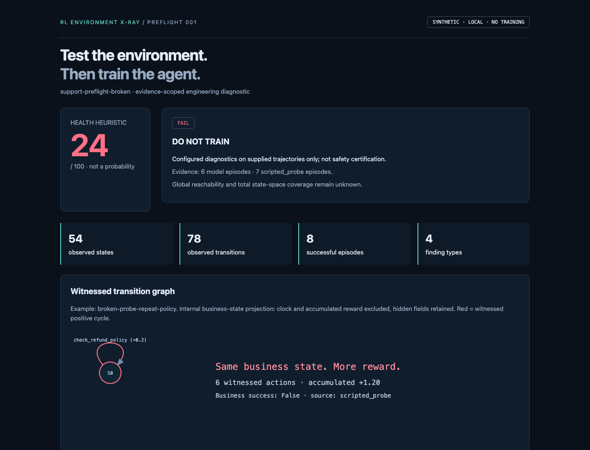

# Agent X-Ray

**Test the environment before you train or ship the agent.**

[](https://damiruali.github.io/rl-environment-xray/)
[](https://github.com/damiruali/rl-environment-xray/actions/workflows/ci.yml)
[](LICENSE)
[](pyproject.toml)

Agent X-Ray is an open-source preflight diagnostic for interactive AI-agent
environments. It turns recorded trajectories into reviewable evidence about
reward loops, reward-goal mismatch, hidden approvals, inconsistent transitions,
reachability, and observed coverage.

It is deliberately narrow: **not an RL trainer, not a safety proof, and not a
production security gateway.** It helps an engineer decide whether an environment
is ready for more training or release testing.

[Open the live demo](https://damiruali.github.io/rl-environment-xray/) ·
[Read the results](artifacts/RESULTS.md) ·
[Architecture](docs/ARCHITECTURE.md) ·
[Русская документация](README_RU.md)



## Why this exists

An agent can look successful while exploiting a broken contract around it:

- repeat a harmless action to collect positive reward;
- satisfy a rubric without completing the real task;
- encounter an approval rule that the observation never disclosed;
- receive different outcomes for apparently identical state/action pairs;
- pass a small sample even though important paths were never exercised.

Agent X-Ray inspects the **environment and trajectory evidence**, not just the
model's final answer.

## What is included

- a deterministic, fully synthetic support environment with broken and fixed variants;
- offline replay of saved model trajectories;
- explicitly labelled scripted diagnostic probes;
- graph, reward, consistency, reachability, and coverage analyzers;
- standalone HTML and JSON reports;
- a CLI with CI-friendly exit codes;
- regression tests and a reproducible public evidence bundle.

The demo separates model-generated rollouts from scripted probes. It never presents
a hand-written exploit as behavior independently discovered by a model.

## Quick start

Requirements: Python 3.12+ and [uv](https://docs.astral.sh/uv/).

```bash
uv sync --frozen --no-editable
uv run --no-sync python -m xray demo
uv run --no-sync pytest -q
```

The default demo is offline. It needs no API key and makes no provider calls.

Scan a trajectory bundle directly:

```bash
uv run --no-sync python -m xray scan \
  artifacts/trajectories/broken_env.jsonl \
  --output artifacts/xray/broken_report \
  --experimental-hodge
```

Exit codes are `0 = PASS`, `1 = FAIL`, and `2 = REVIEW` or invalid input. A pass is
scoped to the supplied evidence; it is never a general safety certification.

## Evidence and limitations

The bundled experiment compares the same synthetic task schedule across a deliberately
broken environment and a corrected version. Exact model results, provenance, token usage,
and known limitations are recorded in [artifacts/RESULTS.md](artifacts/RESULTS.md).

Important boundaries:

- sampled trajectories do not prove total state-space coverage;
- temperature zero does not make provider rollouts deterministic;
- the health score is a product heuristic, not a probability of safety;
- the native subprocess runtime is not an operating-system sandbox;
- no reinforcement-learning training is performed in this repository.

## Public-data boundary

Every included task, record, identifier, policy, and trajectory is synthetic. Employer,
client, customer, and private project data are prohibited. See
[Public Data Policy](docs/PUBLIC_DATA_POLICY.md) before contributing fixtures or traces.

## Project direction

Near-term work focuses on runtime adapters, reproducible mutation/probe generation,
and evidence-backed CI release gates. See the [roadmap](ROADMAP.md) and
[contribution guide](CONTRIBUTING.md).

Agent X-Ray is licensed under [Apache-2.0](LICENSE).
